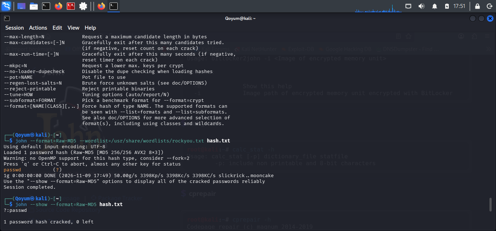
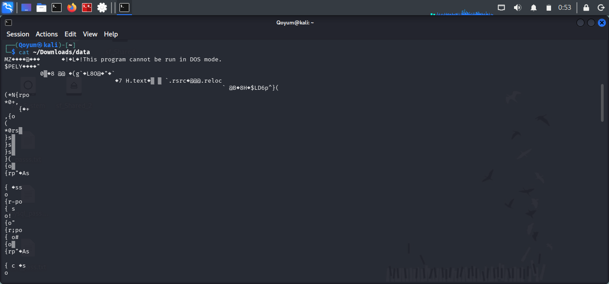
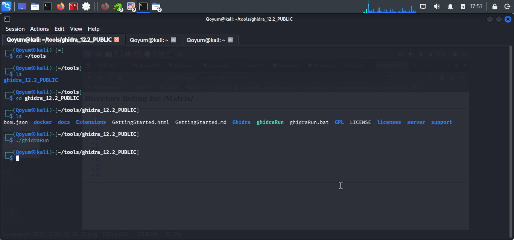
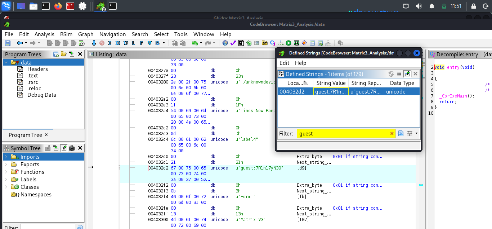

# Credential Discovery

## 1. Cracking the MD5 Hash

The hidden resource discovered during web enumeration contained the following credentials:

```text
admin:76a2173be6393254e72ffa4d6df1030a
```

The hash was identified as MD5 and passed to John the Ripper for password cracking.

```bash
john --format=Raw-MD5 hash.txt
```

The recovered password was:

```text
passwd
```

This provided valid credentials for the Basic Authentication protecting port 7331.

## 2. Analysing the Downloaded File

The `/data` resource was downloaded from port 7331.

File identification revealed that it was a Windows PE32 executable built with Mono/.NET.

```bash
file data
```

The `strings` utility was used to extract readable text from the binary.

```bash
strings -el data
```

Among the extracted strings, the following credentials were discovered:

```text
guest:7R1n17yN30
```

The executable also contained references to its original Windows Forms project.

## Findings

Two sets of credentials were recovered:

| Username | Password | Purpose |
|---|---|---|
| admin | passwd | Access to port 7331 |
| guest | 7R1n17yN30 | SSH access on port 6464 |

The discovered guest credentials provided a route to initial access.

## 3. Static Analysis with Ghidra

To further investigate the downloaded .NET executable, Ghidra was used for static analysis.

The executable was imported into Ghidra, and its analysis was completed using the default analysis options.

The Defined Strings window was examined to identify interesting strings embedded in the executable.

This provided an additional way to inspect the binary and understand some of its contents, including the credentials discovered during the initial strings analysis.

**Tools Used:**
- Ghidra
- GNU Strings
- File

## Screenshots




