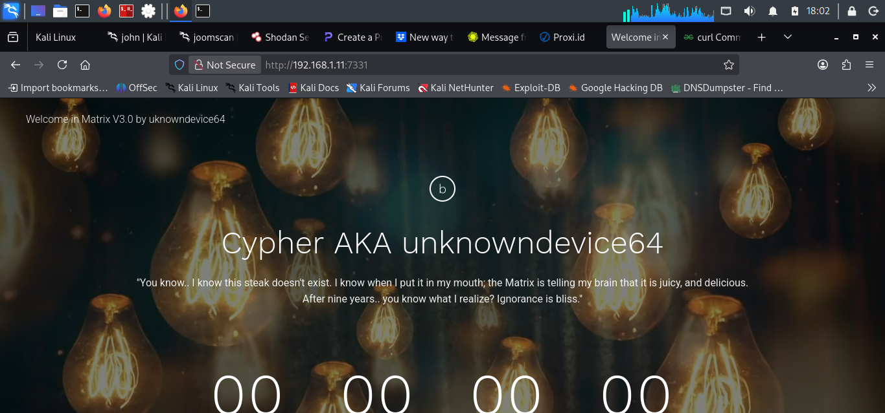
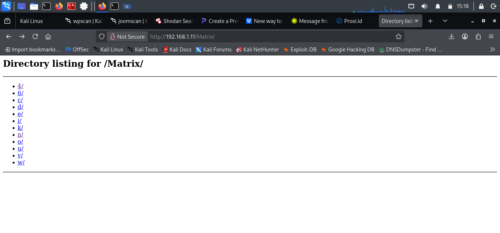
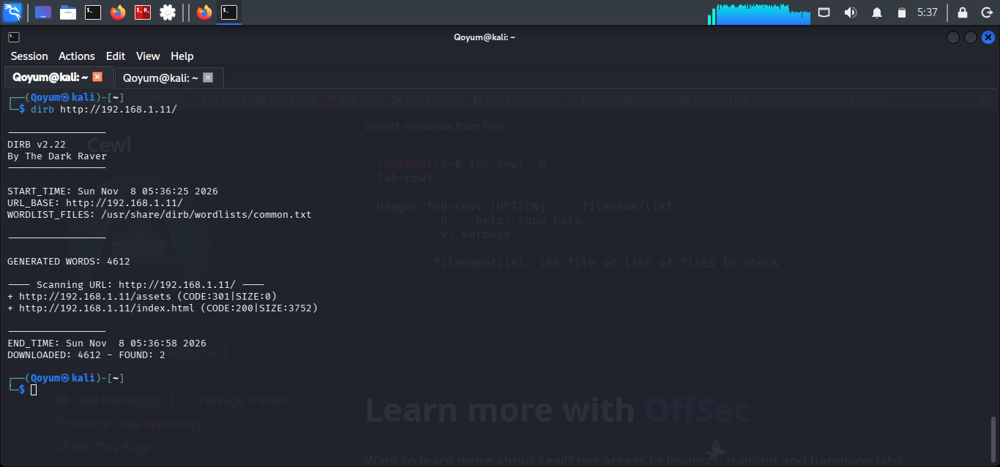
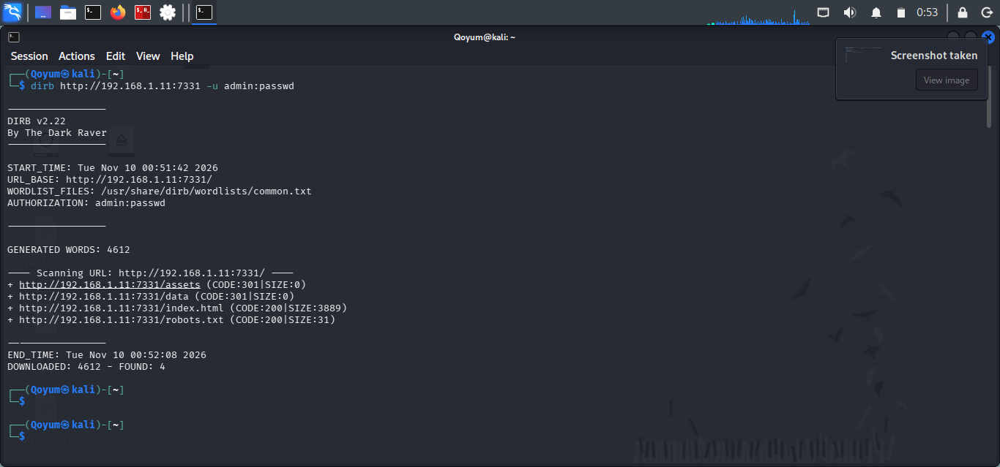
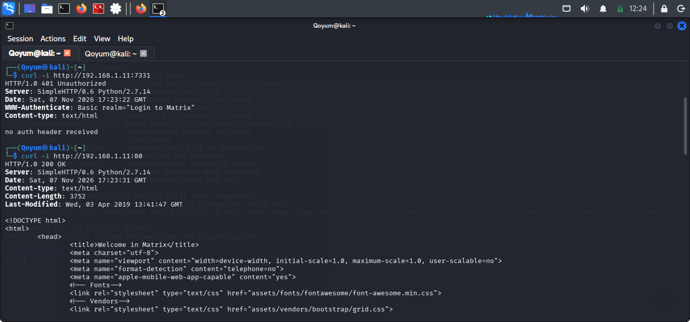

# Web Enumeration

## Port 80 - HTTP

The web service running on port 80 displayed a page titled **Welcome in Matrix**, with the message "Follow The White Rabbit".

Directory enumeration was performed using DIRB:

```bash
dirb http://192.168.1.11
```

The scan identified an `/assets` directory containing an image named:

`Matrix_can-show-you-the-door.png`

Further investigation of the challenge clues led to the discovery of a hidden resource:

```text
/Matrix/n/e/o/6/4/secret.gz
```

Despite its `.gz` extension, the downloaded file contained readable text:

```text
admin:76a2173be6393254e72ffa4d6df1030a
```

The hash was identified as an MD5 hash and cracked using John the Ripper, revealing the password `passwd`.

## Port 7331 - HTTP

The service initially returned an HTTP 401 Unauthorized response with a Basic Authentication challenge.

Using the recovered credentials, access was obtained:

```bash
curl -i -u admin:passwd http://192.168.1.11:7331
```

The page displayed:

- Welcome in Matrix V3.0
- Cypher AKA unknowndevice64

Further directory enumeration was performed:

```bash
dirb http://192.168.1.11:7331 -u admin:passwd
```

Discovered resources included:

- `/assets`
- `/data`
- `/index.html`
- `/robots.txt`

The `robots.txt` file contained:

```text
User-agent: *
Disallow: /data/
```

The `/data` resource was downloaded for further analysis.

## Screenshots





