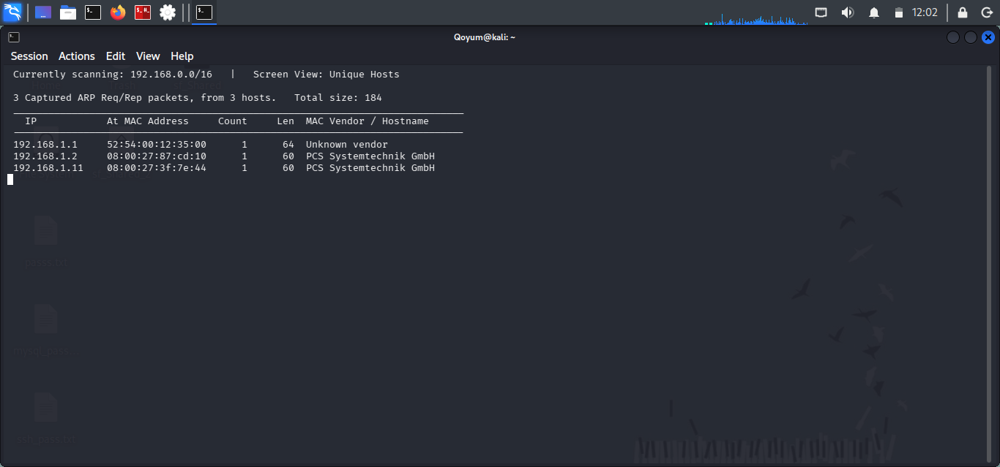
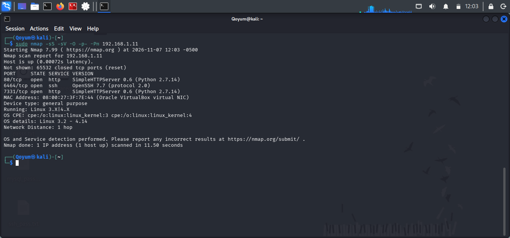

# Reconnaissance

## Target Identification

The target machine was identified on the local network with the IP address `192.168.1.11`.

## Port Scanning and Service Detection

Nmap was used to identify open ports, running services, and service versions.

```bash
sudo nmap -sS -sV -O -p- -Pn 192.168.1.11
```

### Scan Results

| Port | Service | Version / Details |
|---|---|---|
| 80/tcp | HTTP | SimpleHTTPServer 0.6 (Python 2.7.14) |
| 6464/tcp | SSH | OpenSSH 7.7 |
| 7331/tcp | HTTP | SimpleHTTPServer 0.6 (Python 2.7.14) |

## Initial Observations

- Port 80 hosted a webpage titled **Welcome in Matrix**, containing the message "Follow The White Rabbit".
- Port 7331 returned an HTTP 401 Unauthorized response, indicating that authentication was required.
- Port 6464 exposed an SSH service running on a non-standard port.

These findings provided the starting point for further web enumeration and credential discovery.

## Screenshots


